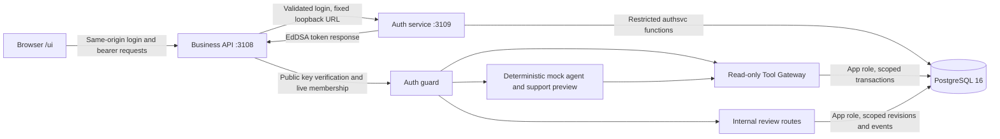
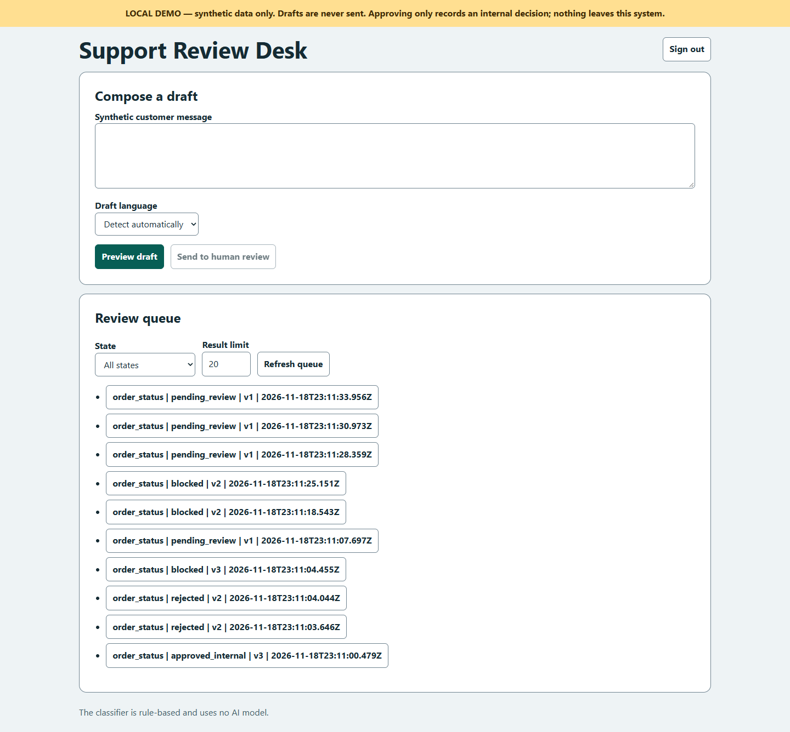
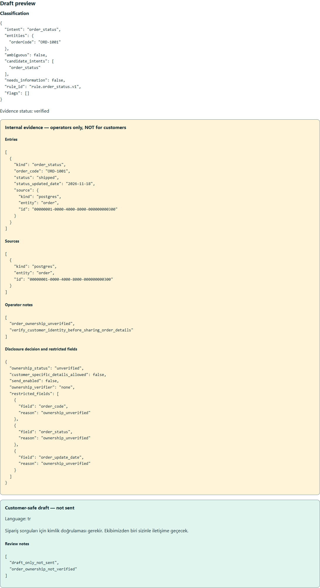
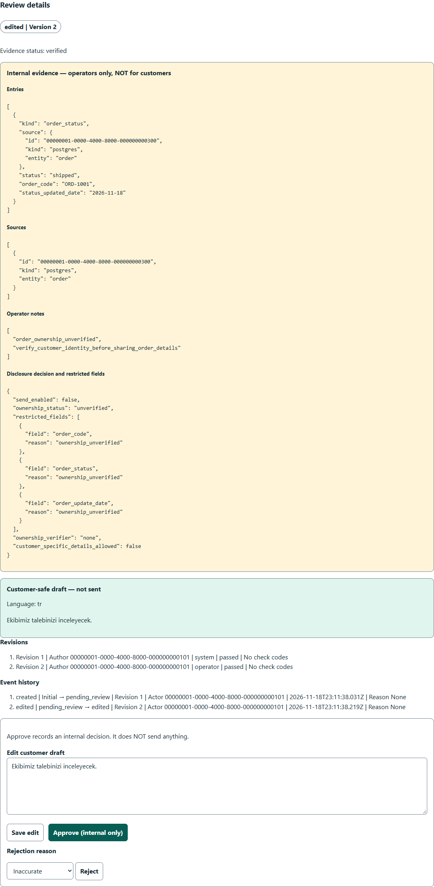

# ProductOps — Secure Multi-Tenant Support Workflow

[](https://github.com/AbdullahBesirArat/productops-ai-agent-portfolio/actions/workflows/ci.yml)

ProductOps is a portfolio MVP built with **TypeScript, Fastify and PostgreSQL**. It models a multi-tenant support-operations workflow with **tenant isolation (PostgreSQL FORCE row-level security) and RBAC**, a **read-only tool gateway**, **deterministic mock-agent orchestration**, **evidence-grounded support drafts**, **human-in-the-loop internal approval**, and **audit trails backed by automated tests**.

> **Honest scope.** This is a local prototype, not a production system. It uses synthetic data only, contains **no real LLM integration** (the "agent" is a deterministic, rule-based mock), **never sends anything to customers**, and has no deployment or live demo. See [Known Limitations](#known-limitations).

## Project Overview

A support operator types a (synthetic) customer message. A rule-based classifier identifies the intent, a bounded agent plans allow-listed read-only lookups (order status, low stock, policy text), and the platform composes two separate outputs: **internal evidence** for operators, and a **customer-safe draft** that withholds order details because customer identity is unverified. The draft goes to a review queue, where a *different* authorised user can approve it. Approval records an internal decision only; `send_enabled` stays `false`.

## Key Features

- **Tenant isolation** — every tenant table uses `FORCE ROW LEVEL SECURITY`; transactions set transaction-local tenant and actor context; the runtime DB role is restricted.
- **RBAC** — owner / member / viewer roles, re-read from live membership on each protected call (a downgraded role takes effect immediately).
- **Separate auth process** — scrypt password checks and EdDSA (Ed25519) JWT signing run in a distinct loopback process with its own restricted DB role; the API only holds public keys.
- **Read-only tool gateway** — allow-listed tools, strict argument schemas, time and call budgets, redacted audit records.
- **Deterministic mock agent** — fixed-rule classification and planning; no model calls, no network access.
- **Evidence grounding and abstention** — drafts cite their sources; missing or contradictory evidence leads to abstention.
- **Disclosure separation** — internal evidence and customer-safe text are produced and stored separately.
- **Human-in-the-loop review** — versioned revisions, append-only events, four-eyes approval, stale-write and race protection, idempotency.
- **Automated tests** — unit, PostgreSQL integration, Chrome end-to-end, reliability fault-injection and a synthetic evaluation set.

## Architecture



Details: [Architecture](docs/portfolio/ARCHITECTURE.md) · [Security model](docs/portfolio/SECURITY_MODEL.md)

## Technology Stack

TypeScript (Node.js 24) · Fastify · PostgreSQL 16 (Docker Compose) · `node:test` with `tsx` · Playwright-style Chrome end-to-end tests · ESLint · GitHub Actions. The UI is a small dependency-free static page served by the API.

## Screenshots

Real captures from the running app using synthetic data (more in the [gallery](docs/portfolio/screenshots/README.md)).

| Review desk | Internal evidence vs. customer-safe draft |
|---|---|
|  |  |



## How It Works

1. **Sign in** — the browser posts to the API, which forwards the login to the auth process; a short-lived EdDSA token is returned.
2. **Preview** — the classifier picks an intent (`order_status`, low stock, policy); the agent plans allow-listed reads through the gateway under the caller's tenant and role.
3. **Compose** — evidence is projected and a customer-safe draft is generated. Order details stay internal because ownership is unverified.
4. **Review** — the operator sends the draft to the review queue, optionally edits it (new revision), and a *different* eligible user approves or rejects it.
5. **Audit** — revisions and events are append-only under the normal application path. Approval is an internal decision; nothing is sent.

## Local Setup

Requirements: Node.js 24, npm, Docker Compose, and Google Chrome (for browser tests). Copy [.env.example](.env.example) to `.env.local` and fill in **your own random local values** (separate passwords per DB role; a 32-byte hex request-digest key). Never commit `.env.local`.

Windows PowerShell:

```powershell
npm.cmd ci
docker compose --env-file .env.local up -d
npm.cmd run db:setup
npm.cmd run demo
```

macOS/Linux: the same with `npm` instead of `npm.cmd`. Open http://127.0.0.1:3108/ui. Stop with Ctrl+C, then `docker compose --env-file .env.local stop`. A more detailed (Turkish) Windows guide is in [docs/LOCAL_SETUP_TR.md](docs/LOCAL_SETUP_TR.md); a demo script is in the [demo runbook](docs/portfolio/DEMO_RUNBOOK.md).

## Running Tests

```powershell
npm.cmd run lint
npm.cmd run typecheck
npm.cmd test              # unit tests, no database needed
npm.cmd run build
npm.cmd run test:db       # PostgreSQL integration (needs the Compose database)
npm.cmd run test:e2e      # Chrome end-to-end
npm.cmd run test:reliability
npm.cmd run eval:chain    # 63 synthetic classifications
```

Results from the published snapshot are recorded in [Engineering evidence](docs/portfolio/ENGINEERING_EVIDENCE.md). CI (`checks` and `db-tests` jobs) runs on every push to this repository.

## Security Boundaries

Tenant isolation, scoped credentials, a read-only gateway and four-eyes review are implemented and tested under ordinary operation. Two boundaries are **deliberately not solved**: the API proxy still sees plaintext login credentials and tokens while both processes share one OS user (**F1, reduced**), and a compromised API process could assert tenant/actor database context (**F2, open**). See [SECURITY.md](SECURITY.md) and the [security model](docs/portfolio/SECURITY_MODEL.md).

## Known Limitations

- Mock agent and rule-based classifier only; no LLM integration, no real-model evaluation.
- Synthetic data only; no real customer data has been used.
- Not production-ready: local deployment, in-memory rate limits, no retention/backup/monitoring design, no penetration test or certification.
- Customer ownership is unverified; nothing is ever sent to customers. Approval is an internal record.
- F2 (compromised API asserting DB context) is open; F1 is reduced, not eliminated.
- Disclosure filters are heuristic; operator-edited text is free text.
- No live demo or hosted deployment.

## Case Study

[Case study](docs/portfolio/CASE_STUDY.md) · [Engineering evidence](docs/portfolio/ENGINEERING_EVIDENCE.md)

## License

Released under the [MIT License](LICENSE).
