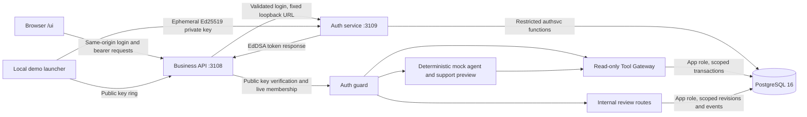

# Architecture

The launcher starts both processes under one OS user and bridges startup readiness. The business API sees credential and token traffic at the login proxy. Its database role cannot use the restricted hash lookup under normal grants. Tenant and actor settings supply transaction context, so their integrity depends on the business runtime. [Launcher](../../scripts/dev.ts) · [Security model](SECURITY_MODEL.md)

The support flow classifies a synthetic request, plans allow-listed reads, projects verified evidence and composes an editable customer-safe draft. Review creation, revision and terminal decisions persist in scoped tables. `approved_internal` changes review state only. Nothing is ever sent. [Support service](../../src/support/service.ts) · [Review migration](../../db/migrations/006_draft_reviews.sql)

## Routes

| Surface | Routes |
|---|---|
| API health | GET `/health` |
| API identity | POST `/auth/login`, GET `/auth/me` |
| API operations | POST `/tools/execute`, `/agent/runs`, `/support/drafts/preview` |
| API review | GET/POST `/support/reviews`, GET/PATCH `/support/reviews/:id`, POST `/support/reviews/:id/approve` and `/reject` |
| API UI | GET/HEAD `/ui`, `/ui/app.js`, `/ui/style.css` |
| Auth process | POST `/auth/login` on its own loopback listener |
